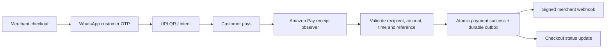

# Better-YouPI-PG

**Amazon Pay receipt verification and WhatsApp checkout OTPs, configured from the admin dashboard.**

An experimental fork maintained by [Raghav6upta](https://github.com/Raghav6upta), based on [YouPI PG](https://github.com/youpi-pg/YouPI-PG), originally credited to [Gaurav](https://github.com/gxurav1710) and Zenuxs. The original checkout and payment lifecycle provide the foundation; this fork adds an Amazon Pay observer and simpler account setup.

> **Experimental beta.** This is browser-based payment observation, not an official Amazon payment API or an audited payment processor. Matching by recipient, amount and time can misattribute an unrelated same-amount transfer. Do not treat it as production-ready. [Limitations](#limitations) ? [Licensing status](LICENSING.md)

## Why this fork?

The original observer flow depends on bank email/SMS notifications. This fork reads incoming UPI receipts from Amazon Pay's web portal, so Amazon mode does not require Gmail OAuth, email polling or an SMS relay.

| Change | Benefit |
| --- | --- |
| Amazon Pay admin tab | Connect, sign in, enable, pause and reconnect from one place |
| Dedicated WhatsApp OTP tab | QR or phone-code linking, saved sessions and a test-message control |
| Honest OTP failure responses | Checkout does not claim a code was sent when dispatch failed |
| Optional customer email | Customers can sign in with WhatsApp without supplying email |
| Receipt ledger and durable webhook outbox | Replay protection and recoverable confirmation delivery |
| Dependency logging protection | Reviewed Signal session logs removed before WhatsApp can start |

Read [the detailed comparison](docs/WHY_THIS_FORK.md). These are changes against the imported baseline, not claims about every future upstream release. No performance benchmark or guaranteed detection latency is claimed.

## How it works



The merchant verifies the webhook HMAC using the raw request body before fulfilling a prepaid order. Browser events are for UI feedback only. Legacy COD/counter paths remain: a COD success means an order was placed, not that money was received.

## Requirements

- **Node.js 24** and npm. The database uses `node:sqlite`; the WhatsApp SDK also needs its native SQLite dependency installed.
- A desktop on the gateway host for the initial Amazon sign-in. The observer then runs in the background.
- Edge or Chrome, or Playwright Chromium: `npx playwright install chromium`.
- An Amazon account with received UPI receipts for the selected receiving UPI ID. Wallet credits are not UPI receipt evidence.
- A WhatsApp account you control for sending customer login codes.

## Quickstart

In a local checkout of this repository:

```sh
npm ci
```

Create the local configuration:

```powershell
# Windows PowerShell
Copy-Item .env.amazon.example .env.amazon-local
```

```sh
# macOS / Linux
cp .env.amazon.example .env.amazon-local
```

Then run:

```sh
npm run dev:amazon
```

Open **http://127.0.0.1:6001**. Unlock the admin dashboard with the contents of `data/.secrets/admin_api_token`, generated locally on first start. Keep it private; never commit it.

1. Configure your receiving UPI account in Store Settings.
2. Open **Amazon Pay**, choose **Connect Amazon Pay**, and sign in yourself in the dedicated browser.
3. Return to the dashboard, read and acknowledge the matching limitation, then **Enable verification**. Wait for **Ready**.
4. Open **WhatsApp OTP**, choose **Connect WhatsApp**, and link the device using your phone. Wait for **Connected**, then send a test message to a number you control.
5. Try your merchant checkout or the optional demo store. Receive the WhatsApp OTP, sign in, and make a small controlled UPI payment. Confirm both checkout status and the verified merchant webhook.

The example keeps settlement disabled until you enable it in the dashboard. It also prevents legacy observers or a competing standalone Amazon browser from starting during setup. No Gmail/SMS configuration is required for this flow.

Full instructions: [Frontend setup](docs/FRONTEND_SETUP.md).

## Merchant integration

Use the existing one-script integration on your merchant page:

```html
<script src="http://localhost:7000/youpi.js"
        data-youpi-key="YOUR_PUBLISHABLE_MERCHANT_KEY"></script>
<button data-youpi-pay data-order-id="ORDER-1001" data-amount="1.00">
  Pay with UPI
</button>
```

Use your deployed checkout origin instead of localhost for a deployed merchant site. Never put webhook secrets, observer tokens or the admin token in frontend code. See [the integration guide](AGENTS.md) for browser events, raw-body webhook verification and idempotency.

## Local services

| Service | Default port |
| --- | --- |
| Merchant admin | 6001 |
| Payment API | 6100 |
| Checkout portal | 7000 |
| Managed Amazon observer | 6004, after connection starts |
| Process supervisor | 8090 |
| Optional demo store | 5000 |

Services bind to loopback by default. Amazon and WhatsApp credentials are stored locally. Keep the same database path and data directory when restarting to retain saved configuration. An unattended remote deployment still needs a way for the operator to complete Amazon sign-in when it expires.

## Tests

```sh
npm test
npm run test:amazon
npm run test:whatsapp
npm audit --omit=dev
```

The curated suite covers core behavior, authentication, logging protection, webhooks and legacy compatibility. The browser suites cover Amazon receipt extraction with fixtures and dashboard setup. They do not make real payments or send real OTPs.

A controlled live test completed WhatsApp OTP login, a small UPI transfer, Amazon receipt matching and signed webhook verification. Saved WhatsApp credentials also reconnected after a restart. OTP delivery was delayed in that test. This is evidence of one working path, not a production SLA.

## Troubleshooting

- **WhatsApp cannot start / SQLite bindings missing:** run `npm rebuild better-sqlite3`, then reconnect.
- **WhatsApp logging protection missing:** run `npm run security:patch-whatsapp`. If the dependency version or source does not match, review it instead of bypassing the check.
- **OTP delayed:** confirm WhatsApp is connected, check the recipient phone, and use checkout's resend control after its cooldown. A send acknowledgement does not guarantee immediate delivery.
- **Amazon asks for login:** use Reconnect in the Amazon Pay tab. Do not open the managed profile in two browser processes.
- **Account unverified:** the initial scan needs a valid received UPI receipt matching your receiving account. An empty history or wallet-only history is insufficient.
- **Pause/change blocked:** wait for active payments to finish before changing the observer account or mode.

## Limitations

- **Order attribution is heuristic.** The receipt has a transfer reference, not a verified merchant order ID. An unrelated same-amount payment or an old saved QR may match a current order.
- Amazon login, page layout changes and service outages can stop receipt extraction. Failed or incomplete scans do not confirm payments.
- The WhatsApp integration uses BerryProtocol and a linked device; it is not the official WhatsApp Business Cloud API.
- One managed Amazon profile and receiving account per host. Multi-tenant isolation, refunds, disputes, reconciliation and production operations need separate work.
- This fork has no online card-acquiring integration and makes no claims of bank/NPCI/Amazon/WhatsApp endorsement.

## Documentation and contributions

- [Frontend setup](docs/FRONTEND_SETUP.md)
- [Why this fork](docs/WHY_THIS_FORK.md)
- [Amazon observer architecture and diagnostics](docs/AMAZON_PAY.md)
- [Merchant integration](AGENTS.md)
- [Security and sensitive logs](SECURITY.md)
- [Contributing](CONTRIBUTING.md)

## License and attribution

New original contributions by Raghav6upta are offered under MIT with attribution retained. The imported upstream code has unresolved licensing metadata, and dependencies retain their own licenses. **The complete repository is not currently represented as MIT-licensed.** Read [LICENSING.md](LICENSING.md) before redistributing it.
